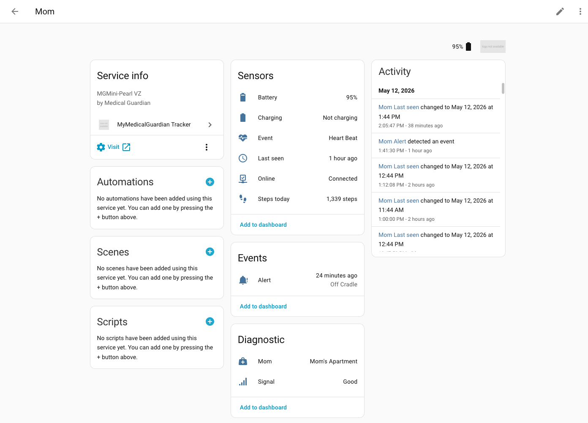
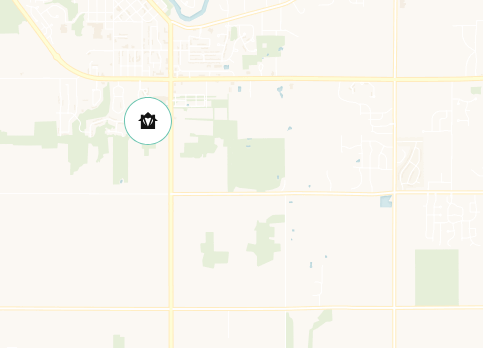

# MyMedicalGuardian Tracker for Home Assistant

[](https://github.com/hacs/integration)
[](https://github.com/uofm-matt/ha-mymedicalguardian/releases)
[](https://github.com/uofm-matt/ha-mymedicalguardian/actions/workflows/validate.yaml)
[](LICENSE)

A Home Assistant integration that turns the [MyGuardian caregiver portal](https://www.mymedicalguardian.com/) into HA entities — **location, battery, signal, daily steps, on-cradle state, and event-bus alerts on Fall / SOS** — for caregivers monitoring a loved one with a [Medical Guardian](https://www.medicalguardian.com/) wearable.

> **Unofficial.** Not affiliated with or endorsed by Medical Guardian. There is no public MG API; this integration logs in with your caregiver-portal credentials and scrapes the server-rendered pages. See [Troubleshooting](#troubleshooting--filing-issues) if it ever stops working.

[](https://my.home-assistant.io/redirect/hacs_repository/?owner=uofm-matt&repository=ha-mymedicalguardian&category=integration) [](https://my.home-assistant.io/redirect/config_flow_start?domain=mymedicalguardian)



## What it does

- Shows the wearer on the HA **Map** card
- Powers a **Person** entity (use their photo as the map marker, build automations on their state)
- Fires HA bus events on `Fall`, `SOS`, `On Cradle`, `Off Cradle` (etc.) for instant automation
- Exposes battery %, cell signal label, daily step count, online/charging state — so you can dashboard or alert on any of them

## Supported devices

The integration is agnostic to which Medical Guardian device you have — it reads whatever the caregiver portal shows. Confirmed working:

| Device | Portal model string | Notes |
|---|---|---|
| MG Mini (Pearl VZ) | `MGMini-Pearl VZ` | Step counts populated; hourly heartbeat |
| MG Mobile 2.0 | `MGMobile2` | Heartbeat, no step data |
| Classic Guardian | `MGClassic` | Static unit; battery only, no GPS heartbeats |

If you have a different model and it works (or doesn't), please [open an issue](https://github.com/uofm-matt/ha-mymedicalguardian/issues) with the portal's model string from Diagnostics — happy to add it here.

## Entities

The integration creates one **device** per configured account (named whatever you picked in the config flow — e.g. "Mom") and the entities below. Each entity name auto-prefixes with the device name: `Mom Battery`, `Mom Steps today`, etc.

| Entity | Class | What |
|---|---|---|
| `device_tracker.<title>_location` | `device_tracker` | Latest GPS coords; state is the matching zone or `not_home` |
| `sensor.<title>_event` | `sensor` | Most recent event type — `Heart Beat`, `SOS`, `Fall`, `Manual Test`, `Power On` |
| `sensor.<title>_last_seen` | `sensor` (timestamp) | When the latest observation was recorded — renders as "5 min ago" |
| `sensor.<title>_battery` | `sensor` (battery, %) | Device battery percentage |
| `sensor.<title>_signal` | `sensor` (diagnostic) | Cell signal label — `"Good"`, `"Fair"`, `"Poor"`, or the literal string `"None"` |
| `sensor.<title>_steps_today` | `sensor` (total_increasing) | Step count for the day. Extra attrs: `miles`, `calories` |
| `binary_sensor.<title>_online` | `binary_sensor` (connectivity) | `on` if a heartbeat arrived recently (≥90 min, and never less than the poll interval + 30 min) |
| `binary_sensor.<title>_charging` | `binary_sensor` (battery_charging) | `on` while the device sits on its charging cradle |
| `event.<title>_alert` | `event` | Fires on each new alert: `Heart Beat`, `On Cradle`, `Off Cradle`, `Fall`, `SOS`, `Manual Test`, `Power On`. Use this (not `sensor.<title>_event`'s state change) to automate on Fall/SOS |

## Privacy

This integration tracks a person's location, behaviour, and biometrics — please read this **before** you install:

- **Credentials** — your MyGuardian email + password are stored in HA's standard config-entry storage (plain JSON under `/config/.storage/`, protected by your filesystem's permissions). They are not logged and never leave HA except in the outbound POST to `mymedicalguardian.com/ajax_handlers/account/login`.
- **No third parties** — the integration only talks to `mymedicalguardian.com`. No telemetry, no analytics, no cloud sync.
- **HA recorder** — every entity-state change is persisted by HA's recorder. By default that's 10 days, configurable via `recorder.purge_keep_days`. Persisted data includes the wearer's coordinates, address strings as MG geocoded them, event types, battery level, signal label, step count, and timestamps. If your HA database is exfiltrated, that history goes with it.
- **HA event bus / Logbook** — the `event.<title>_alert` entity emits Fall / SOS / Cradle events. The event data carries `address`, `location.{latitude, longitude}`, and `observed_at`. These are visible to anyone with access to HA's UI (Developer Tools → Events, Logbook, automations).
- **Diagnostics download** — Settings → Devices & Services → ⋮ → Download diagnostics redacts email, password, the device name/title, address, latitude, longitude. It does **not** redact `battery_percent`, `charging`, `signal_label`, `steps_today`, `device_model`, or any `observed_at` / `observed_raw` timestamps. Those describe the wearer's behaviour over time; treat the file as sensitive even after redaction. The bug-report issue template reminds you to sanitise further before posting publicly.
- **Multi-user HA** — anyone with login access to your HA instance can see all the entity states and attributes above. There is no per-user scoping for caregiver-tracker data.

If you want tighter privacy: shorten `recorder.purge_keep_days`, restrict HA login to a single trusted user, and never paste un-paraphrased diagnostics in a public bug report.

## Installation

### Via HACS (recommended)

1. In HACS, open the **⋮** menu → **Custom repositories**
2. Add `https://github.com/uofm-matt/ha-mymedicalguardian` as type **Integration**
3. Find "MyMedicalGuardian Tracker" in the integrations list, install
4. Restart Home Assistant
5. **Settings → Devices & Services → Add Integration** → search "MyMedicalGuardian Tracker"

Changelogs live in [Releases](https://github.com/uofm-matt/ha-mymedicalguardian/releases).

<details>
<summary>Manual install (without HACS)</summary>

1. Copy `custom_components/mymedicalguardian/` into your HA `config/custom_components/`
2. Restart Home Assistant
3. **Settings → Devices & Services → Add Integration** → "MyMedicalGuardian Tracker"

</details>

## Configuration

The config flow takes:

- **Name** — display title for the device. This prefixes every entity (e.g. `Mom`, `Dad`, `Grandma`). You can rename later via the device card.
- **Email / username** — your MyGuardian login
- **Password**

After setup, click **Configure** on the integration card to adjust:

- **Scan interval (minutes)** — default 10, minimum 10, max 120

The integration handles login, session management, and CSRF on its own. Credentials are stored in HA's standard config-entry storage and never logged.

If you ever need to change the email or update the password, use **⋮ → Reconfigure** on the integration card.

## How data is updated

The device emits a heartbeat with GPS / cell-tower location roughly once an hour. We poll the caregiver portal every 10 min by default — **expect ~10–20 min latency between when the device records a reading and when HA shows it**, with occasional 30+ min lag when the wearable's cell signal is poor.

This is **not real-time tracking**. If you need second-precision GPS, this is the wrong tool. The integration polls inside HA only; your credentials never leave HA.

## Use cases & example automations

Drop these in your `automations.yaml` (adjust entity IDs to match your install). Each one is intentionally small — wire `script.notify_family` or a `notify` service of your choice into the action.

### Notify on Fall / SOS

```yaml
- alias: "Mom: emergency alert"
  trigger:
    - platform: state
      entity_id: event.mom_alert
  condition:
    - "{{ trigger.to_state.attributes.event_type in ['Fall', 'SOS'] }}"
  action:
    - service: notify.family_group
      data:
        title: "🚨 {{ trigger.to_state.attributes.event_type }} alert"
        message: >-
          Mom triggered {{ trigger.to_state.attributes.event_type }}
          at {{ trigger.to_state.attributes.address }}
          ({{ trigger.to_state.attributes.observed_at }})
```

### Low-battery warning

```yaml
- alias: "Mom: low battery"
  trigger:
    - platform: numeric_state
      entity_id: sensor.mom_battery
      below: 25
      for: "00:30:00"
  condition:
    - condition: state
      entity_id: binary_sensor.mom_charging
      state: "off"
  action:
    - service: notify.me
      data:
        message: "Mom's MG device is at {{ states('sensor.mom_battery') }} %. Remind her to charge."
```

### Stale-data alarm

```yaml
- alias: "Mom: device offline"
  trigger:
    - platform: state
      entity_id: binary_sensor.mom_online
      to: "off"
      for: "02:00:00"
  action:
    - service: notify.me
      data:
        message: "No update from Mom's MG device in over 2 hours. Check the portal."
```

### Zone-crossing notify

```yaml
- alias: "Mom: left home"
  trigger:
    - platform: state
      entity_id: person.mom
      from: "Mom's Apartment"
  action:
    - service: notify.me
      data:
        message: "Mom left her apartment {{ now() }}. Headed to {{ states('person.mom') }}."
```

### Map / Person tips



1. **Add a Person entity** for the wearer (Settings → People → Add Person), upload their photo, select their `device_tracker.*_location`. The map marker becomes the photo.
2. **Add zones** for places that matter — `Mom's Apartment`, `Mom's Church`, `Doctor`. The device's GPS jitter is ~25–75 m at any fixed address; **40–80 m radii** match tightly (her apartment) and **150–300 m radii** match generously (a campus or shopping center).

<br clear="right"/>

## Known limitations

- **Only one care recipient.** If your MyGuardian login covers multiple wearers, the integration uses the portal's auto-selected default and logs a warning that the others are ignored. Full multi-recipient support is on the roadmap.
- **No on-demand refresh.** The "Ring my device" button on the portal isn't surfaced. Polling is read-only.
- **Posting lag is bimodal.** As described in *How data is updated* — sometimes ~1 min, sometimes 30 min. The integration cannot make MG faster.
- **No real-time push.** MG provides no push API, websocket, or webhook for caregivers; everything is poll-based.
- **Markup-scrape.** When MG changes the caregiver portal markup, this integration may break. Parser-drift failures appear in the log at debug level, and after 24 h of consecutive fetch failures a Repair issue is raised.
- **Alert-type labels verified against real data:** `Heart Beat`, `On Cradle`, `Off Cradle`. The parser passes any other string through verbatim, so `Fall`, `SOS`, `Manual Test`, `Power On` will fire correctly if MG returns those exact strings. If you actually trigger a Fall or SOS and the integration mis-labels it, please file an issue with the observed `event_type` attribute on the event entity.
- **No battery alert from MG itself.** The portal sends a low-battery alert via email/SMS but doesn't expose it on the dashboard feed; do battery automations on `sensor.<title>_battery` directly.

## Troubleshooting & filing issues

1. **First check the integration log** at Settings → System → Logs (filter `mymedicalguardian`). Debug-level lines show parser hits/misses.
2. **Download diagnostics** from Settings → Devices & Services → MyMedicalGuardian Tracker → **⋮ → Download diagnostics**. Email, the device name, and address are redacted automatically — safe to attach to public issues.
3. **Repair UI** — if the portal is unreachable for >24 hours, a repair issue appears in Settings → Repairs with the last error. This is also the canonical sign that something needs your attention.
4. **Open an issue** at [github.com/uofm-matt/ha-mymedicalguardian/issues](https://github.com/uofm-matt/ha-mymedicalguardian/issues) with the diagnostics download, your HA version, and the symptoms.

## Removal

1. **Settings → Devices & Services**, click the MyMedicalGuardian Tracker entry
2. **Delete** the integration; the device and all entities go with it
3. *(optional)* Delete the zones, Person entity, and any automations you tied to it
4. *(only if you installed manually)* `rm -r /config/custom_components/mymedicalguardian/`

Your MyGuardian credentials are wiped from HA's config-entry storage on uninstall.

## License

MIT. See [LICENSE](LICENSE).
